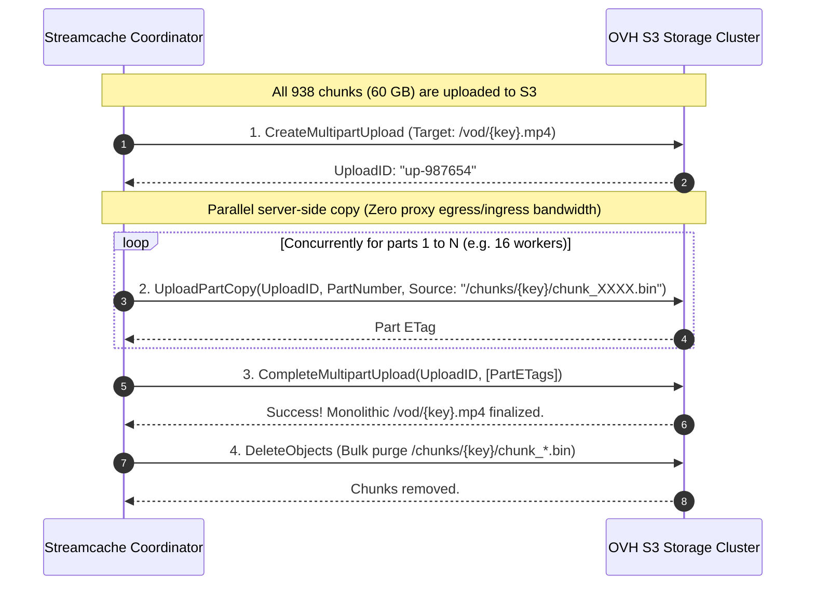

# Streamcache S3 Storage Backend - Architecture & Implementation Plan

> **Status**: Future Potential Feature / Design Proposal  
> **Target Backends**: OVHcloud Object Storage, AWS S3, Cloudflare R2, MinIO, Ceph, Backblaze B2  
> **Author**: Streamcache Engineering & Architecture Speculation

---

## 1. Executive Summary

Streamcache's primary deployment model currently persists fully cached VOD files to local POSIX disk storage. However, high-bitrate Video-on-Demand (such as **4K/UHD remuxes ranging from 40 GB to 80+ GB**) presents a major challenge when running on lightweight VPS instances or appliances with limited NVMe/SSD space (e.g., 20–40 GB total free space).

This document outlines the architectural plan to introduce a **pluggable S3-compatible storage backend** that:
1. **Caps local scratch disk consumption to 2–4 GB**, regardless of whether the media file is 2 GB or 100 GB.
2. **Progressively uploads 64 MB chunks to S3** as network slices arrive, freeing local disk blocks immediately.
3. **Serves lagging or concurrent viewers (e.g., Viewer B at 0% while Viewer A is at 80%) directly from S3 chunks** with zero local disk writes and zero redundant upstream origin requests.
4. **Recomposes chunks server-side into a single monolithic S3 object** via `UploadPartCopy` once 100% downloaded, using **zero proxy bandwidth**.
5. **Preserves upstream origin revalidation**, checking against the origin provider (not S3) to guarantee cache freshness before serving S3 assets.

---

## 2. Storage Tiering & Architecture

```mermaid
flowchart TD
    Origin["Upstream Origin CDN (IPTV Provider)"]

    subgraph Proxy ["Streamcache Proxy Node"]
        Coordinator["Upstream Multi-Worker Coordinator"]
        Scratch["Local Scratch Window (Capped at 2-4 GB)"]
        Reader["Multi-Tier CacheReader"]
    end

    subgraph S3 ["OVHcloud S3 Object Store"]
        Chunks["Temporary Chunk Objects<br/>/chunks/{key}/chunk_0000.bin (64MB)"]
        Monolithic["Final Monolithic Object<br/>/vod/{key}.mp4"]
    end

    subgraph Players ["Client Video Players"]
        P1["Viewer 1 (Watching live hydration at 80%)"]
        P2["Viewer 2 (Starting at 0% or rewinding)"]
        P3["Viewer 3 (Watching after 100% complete)"]
    end

    Origin -->|128KB Network Slices| Coordinator
    Coordinator --> Scratch
    Scratch -->|< 1ms TTFB| P1

    Scratch -->|Chunk Complete -> PUT Object| Chunks
    Scratch -.->|Free Local Blocks| Scratch

    P2 -->|Read Offset 0| Reader
    Reader -->|Fetch Byte-Range| Chunks
    Chunks -->|~15ms TTFB (Zero Local Disk)| P2

    Chunks -->|All Chunks Done -> Server-Side UploadPartCopy| Monolithic
    Monolithic -.->|Purge Temporary Chunks| Chunks

    P3 -->|Cache HIT| Monolithic
```

### Storage Hierarchy

| Tier | Location | Scope | Max Size | Eviction Policy |
| :--- | :--- | :--- | :--- | :--- |
| **Tier 1: Scratch** | Local NVMe/SSD | Active hydration sliding window (in-flight network slices + active playback buffer) | 2–4 GB (Configurable) | Aggressive: deleted as soon as S3 confirms chunk upload |
| **Tier 2: S3 Chunks** | OVH S3 | Ephemeral 64 MB chunk objects (`prefix/chunks/{key}/chunk_XXXX.bin`) | Equal to active download size | Transformed server-side into Tier 3 once 100% complete, then deleted |
| **Tier 3: Monolithic** | OVH S3 | Permanent finalized media file (`prefix/vod/{key}.ext`) + S3 Metadata headers | Persistent (e.g. 50+ TB) | LRU / Bucket Lifecycle policies / Upstream Revalidation eviction |

---

## 3. Multi-Viewer & Starvation Dynamics

A core requirement of Streamcache is preventing redundant upstream connections to the IPTV provider. The S3 backend must handle multiple concurrent viewers at disparate playback offsets without breaking this guarantee:

### Case Study: Viewer 1 at 80%, Viewer 2 at 0%
1. **Viewer 1 (Leading Player at 80%)**:
   - The coordinator downloads network slices into local scratch.
   - Viewer 1 reads directly from the local scratch window with sub-millisecond TTFB.
   - As each 64 MB boundary completes, a background worker uploads the chunk to S3.
   - Once S3 returns `200 OK`, the local 64 MB block is released (or truncated/unlinked).
2. **Viewer 2 (Trailing Player at 0%)**:
   - Viewer 2 requests `Range: bytes=0-2097151`.
   - The `CacheReader` checks the chunk registry: chunk 0 is marked `CommittedToS3`.
   - **Zero Upstream CDN Traffic**: The coordinator does not open an origin connection.
   - **Zero Local Disk Usage**: The proxy streams `chunk_0000.bin` directly from OVH S3 through a small in-memory buffer (e.g. 4–8 MB in RAM) straight into Viewer 2's HTTP response.
3. **Viewer 3 (Seeking Ahead to 95%)**:
   - If Viewer 3 seeks beyond Viewer 1, they starve for un-downloaded bytes.
   - Streamcache's existing Starvation Scheduler ([coordinator.go](file:///home/adrien/opencode_projects/SC2/coordinator.go)) detects starvation and leapfrogs upstream download workers to fetch the 95% range immediately into local scratch.

---

## 4. Server-Side Recomposition Workflow

When the last byte of the 60+ GB file finishes downloading:



### S3 Specifications & Invariants
- **Chunk Size: 64 MB**:
  - Minimum S3 part size is **5 MB** (64 MB easily satisfies this).
  - Maximum S3 multipart count is **10,000 parts**. A 64 MB chunking scheme allows files up to **640 GB** before hitting the 10,000 part limit.
- **Non-Disruptive Transition**:
  - `UploadPartCopy` copies internal storage pointers without removing the source chunks.
  - Active trailing viewers (e.g., Viewer 2 at 15%) continue reading chunks without interruption while recomposition occurs.
  - Once `CompleteMultipartUpload` completes, any new reads transition to byte-range requests on `/vod/{key}.mp4`, and the chunks are safely deleted.

---

## 5. Upstream Origin Revalidation

Revalidation follows the principle that **the upstream IPTV provider is the source of truth, and OVH S3 is the persistent cache**:

1. **Metadata Persistence**:
   - `FileMeta` properties (`TotalSize`, `ETag`, `LastModified`, `LastValidated`, `URL`) are persisted as S3 User Metadata headers (`x-amz-meta-*`) on the monolithic object, or as an adjacent lightweight JSON object.
2. **In-Memory Metadata Cache**:
   - To avoid adding 15–30 ms of S3 `HeadObject` latency on every player request, metadata is cached in RAM.
   - While `time.Since(LastValidated) < CACHE_REVALIDATE_INTERVAL`, hits are served immediately from S3.
3. **Expired Probe Flow**:
   - When the validation interval expires, Streamcache probes the **upstream origin** (`If-None-Match: <etag>`, `If-Modified-Since: <last_mod>`, or `Range: bytes=0-0`).
   - **304 Not Modified**: S3 object is fresh. Update `LastValidated` in S3 metadata via `CopyObject` (metadata replace). Zero media bytes transferred.
   - **Media Changed (200 / 206 with new ETag or Size)**: Evict/delete the stale S3 object, allocate local scratch, and re-hydrate the new stream.
   - **Origin Deleted (404 / 410)**: Delete the S3 object to reclaim bucket storage, and cache a failure tombstone.

---

## 6. Proposed Codebase Architecture & Interfaces

### 6.1 Abstract Storage Backend Interface

A new `StorageBackend` interface cleanly separates ingestion and streaming from storage persistence:

```go
type StorageBackend interface {
    // Stat checks if a completed or partial cache entry exists
    Stat(ctx context.Context, key string) (*FileMeta, CacheStatus, error)

    // OpenRange opens an io.ReadCloser for a byte range on a committed monolithic object
    OpenRange(ctx context.Context, key string, offset, length int64) (io.ReadCloser, error)

    // OpenChunkRange opens an io.ReadCloser for a byte range within a specific temporary chunk
    OpenChunkRange(ctx context.Context, key string, chunkIndex int, offset, length int64) (io.ReadCloser, error)

    // UploadChunk persists a completed scratch chunk into S3 Tier 2
    UploadChunk(ctx context.Context, key string, chunkIndex int, r io.Reader, size int64) error

    // Recompose stitches uploaded chunks into a final Tier 3 monolithic S3 object
    Recompose(ctx context.Context, key string, totalParts int, meta FileMeta) error

    // Delete purges an asset (and its chunks) from storage
    Delete(ctx context.Context, key string) error

    // UpdateMetadata refreshes validation timestamps on S3
    UpdateMetadata(ctx context.Context, key string, meta FileMeta) error
}
```

### 6.2 Reader Resolution Strategy

The [`CacheReader.ReadAt`](file:///home/adrien/opencode_projects/SC2/cache_reader.go#L198) method resolves requested byte ranges through a tiered resolution hierarchy:

```
Requested Range [Offset, Offset+Len]
  │
  ├─ 1. Is offset within Local Scratch Buffer? 
  │     └─► YES: Read directly from local disk via os.File.ReadAt (<1ms TTFB)
  │
  ├─ 2. Has the monolithic file been recomposed?
  │     └─► YES: Stream via S3 Range GET on /vod/{key}.mp4 (~15ms TTFB)
  │
  ├─ 3. Is the chunk containing Offset already committed to S3?
  │     └─► YES: Stream via S3 Range GET on /chunks/{key}/chunk_XXXX.bin (~15ms TTFB)
  │
  └─ 4. Offset not yet downloaded?
        └─► YES: Register Starvation -> Coordinator downloads slice from Origin CDN
```

---

## 7. Phased Implementation Roadmap

### Phase 1: Storage Backend Abstraction
- Define `StorageBackend` and `StorageReader` interfaces in a new `storage/` package.
- Wrap current local filesystem operations (`os.Open`, `os.Rename`, `os.Remove`, `os.ReadDir`) into a `LocalStorageBackend` implementing this interface.
- Ensure 100% backward compatibility with all existing test suites.

### Phase 2: S3 Client & Direct Monolithic Upload (Small Files)
- Integrate AWS SDK for Go v2 (configured for OVH S3 endpoints and S3-compatible alternatives).
- Implement standard S3 monolithic upload for files under a threshold (e.g. `< 10 GB`), uploading via background multipart upload upon completion.
- Implement S3 byte-range proxying with small (2–4 MB) in-memory read-ahead buffering.

### Phase 3: Rolling Scratch Window & Progressive Chunk Uploader
- Implement chunk-based local scratch manager:
  - Fixed 64 MB partition boundaries.
  - Automatic upload trigger as each 64 MB block is completed.
  - Local block release upon confirmed S3 receipt.
- Add configuration parameters:
  - `STORAGE_BACKEND=s3` (`local` or `s3`)
  - `S3_ENDPOINT=s3.<region>.io.cloud.ovh.net`
  - `S3_BUCKET=<bucket_name>`
  - `S3_REGION=<region>`
  - `S3_ACCESS_KEY=<key>`
  - `S3_SECRET_KEY=<secret>`
  - `S3_CHUNK_SIZE_MB=64`
  - `S3_SCRATCH_MAX_BYTES=4GB`

### Phase 4: S3 Chunk Reader for Concurrent Viewers
- Update [`CacheReader`](file:///home/adrien/opencode_projects/SC2/cache_reader.go) to read seamlessly from S3 chunk objects when the requested offset is behind the active local scratch window.
- Verify that trailing viewers (Viewer 2 at 0%) consume zero local scratch space and zero origin CDN connections.

### Phase 5: Server-Side Recomposition (`UploadPartCopy`)
- Implement background recomposition routine triggered upon 100% completion of all chunks.
- Implement concurrent `UploadPartCopy` workers (10–20 workers).
- Implement post-recomposition reader migration and bulk deletion of temporary chunk objects.

### Phase 6: S3 Revalidation & Dashboard Telemetry
- Update [revalidator.go](file:///home/adrien/opencode_projects/SC2/revalidator.go) to inspect and update S3 metadata.
- Expose S3 storage metrics (committed S3 bytes, active chunk count, recomposition queue) on the real-time SSE Web Dashboard ([dashboard.go](file:///home/adrien/opencode_projects/SC2/dashboard.go)).

---

## 8. Risks, Edge Cases & Mitigations

| Risk / Edge Case | Impact | Mitigation |
| :--- | :--- | :--- |
| **Viewer abandons 4K stream after 5 mins** | Chunks 0–5 remain in S3 indefinitely | Incomplete download garbage collector purges abandoned chunk prefixes after all clients disconnect and idle timeout expires. |
| **Network glitch during S3 chunk upload** | Upload worker fails | Exponential backoff retry cycle; keep local chunk on disk until S3 `200 OK` is received. |
| **High S3 API request latency on small reads** | Player buffering stutter | Implement a small in-memory sliding read-ahead buffer (4–8 MB) in `S3RangeReader` to coalesce reads. |
| **Mid-stream origin file replacement** | Player receives mismatched video chunks | Key S3 objects with origin ETag hash (e.g. `/vod/{key}_{etag}.mp4`) so in-flight streams finish cleanly on old version while new requests re-hydrate. |
